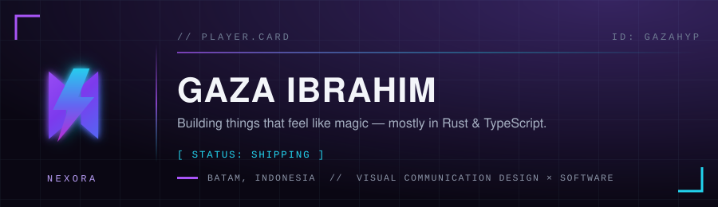
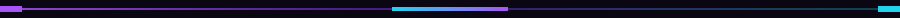
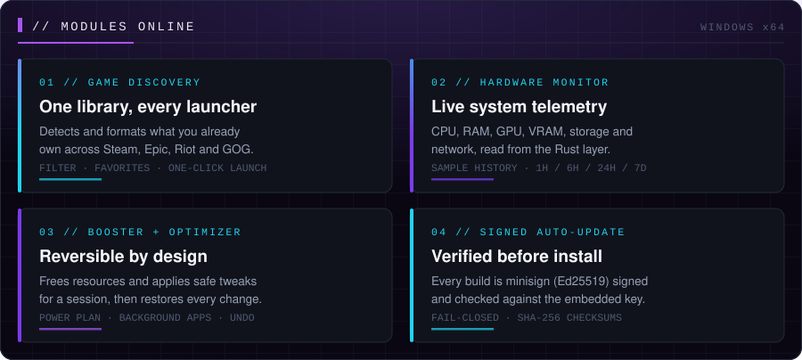
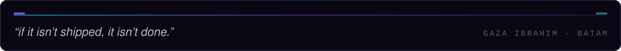

 

<!-- Primary action row — for-the-badge, dark labels, neon accents. The release
     and download badges are LIVE: they follow the NEXORA repo, no hand edits. -->

## `NEXORA // CONTROL HUB`

A **Windows gaming control hub** I build solo with **Tauri 2 · Rust · React** — a real desktop app, not a mockup, and the reason this profile exists.

**[Download it →](https://gazahyp.github.io/NEXORA/)** · [Releases](https://github.com/gazahyp/NEXORA/releases) · [Issue tracker](https://github.com/gazahyp/NEXORA/issues)

## `LOADOUT`

| | |
|:--|:--|
| **Runtime** |    |
| **Shell** |    |
| **Data & shipping** |   |
| **Visual** |  typography · layout · brand systems |

## `CONNECT`

| | |
|:--|:--|
| **Project** | [gazahyp.github.io/NEXORA](https://gazahyp.github.io/NEXORA/) |
| **Issues** | [github.com/gazahyp/NEXORA/issues](https://github.com/gazahyp/NEXORA/issues) |
| **Contact** | `TODO` — opening an issue is the working channel today |
| **Elsewhere** | `TODO` — nothing published yet, no links invented |

